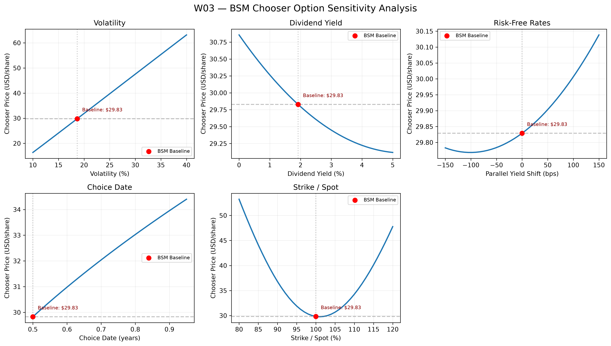

# W03 — Weekly Research Progress Report

**Project:** Advanced Chooser Option Pricing Model with Real-World Data & Machine Learning\
**Reporting period:** October 22–28, 2026\
**Stage:** Dividend-adjusted BSM Chooser Option Baseline\
**Status:** Completed; documented model checks passed

## 1. Executive Summary

Implemented a **European Simple Chooser Option** baseline for JPM using dividend-adjusted Black–Scholes–Merton (BSM) pricing and put–call parity decomposition. The estimated theoretical chooser value is **\$29.8290** as of December 31, 2024. Tested the choice rule, pricing consistency, and sensitivity to five model inputs.

## 2. Inputs & Method

| Input | Value / method |
|------------------------------------|------------------------------------|
| Underlying / valuation date | JPM / 2024-12-31 |
| Spot price / strike | **\$239.71 / \$239.71** (at the money) |
| Choice date / final expiry | **0.5 / 1.0 years** |
| Annualized volatility | **18.67%**, trailing 20-day historical estimate |
| Dividend yield | **1.919%**, \$4.60 trailing annual dividends / \$239.71 spot |
| Risk-free yield proxies | **4.24% (6M)** / **4.16% (1Y)** |
| Implied 6M–1Y forward-rate proxy | **4.08%** |

**Pricing method:** Dividend-adjusted BSM European call and put, followed by the simple chooser decomposition:

$$
V_0 = C(S_0,K,T_2) + P\!\left(S_0 e^{-q(T_2-T_1)},\;K e^{-f(T_2-T_1)},\;T_1\right).
$$

In this decomposition, the **adjusted European put leg expires at the choice date** $T_1=0.5$ and uses the 6M rate proxy; the original European call leg expires at $T_2=1.0$ and uses the 1Y proxy. At $T_1$, the holder compares the **call and put continuation values**, rather than looking ahead to final payoffs.

## 3. Pricing & Validation

| Theoretical component | Price |
|------------------------------------|-----------------------------------:|
| **European call leg — expiry** $T_2$ (1Y) | **\$20.0223** |
| European put — expiry $T_2$ (1Y), *reference only* | **\$14.8111** |
| **Additional choice value — adjusted European put leg, expiry** $T_1$ (6M) | **\$9.8067** |
| **Simple chooser option = call leg + adjusted put leg** | **\$29.8290** |

The Simple Chooser Option can be decomposed into a standard European call and an adjusted European put:

$$
V_0 = C_{\mathrm{BSM}}(S_0,K,T_2)
+ \underbrace{P_{\mathrm{BSM}}(S_0',K',T_1)}_{\text{Adjusted Put Leg}}
$$

where:

$$
S_0' = S_0 e^{-q(T_2-T_1)}, \qquad
K' = K e^{-f(T_2-T_1)}
$$

Here, $q$ is the continuous dividend yield, and $f$ is the implied forward rate between $T_1$ and $T_2$.

**Additional Choice Value (\$9.8067)** corresponds to the **Adjusted European Put Leg**, expiring at the choice date $T_1$, rather than the original European put expiring at $T_2$.

This adjusted put leg represents the additional flexibility to choose the put when its continuation value exceeds that of the call at $T_1$.

**Leg clarification:** The **\$9.8067** is the price of the *adjusted put expiring at the choice date*, not the \$14.8111 original 1Y put. It captures the value of choosing the put instead of the call when the put has the higher continuation value at $T_1$.

**Passed checks:** BSM put–call parity (error: **0.0**); expected dividend sensitivity; chooser value ≥ individual call/put; two equivalent chooser decompositions (both **\$29.829018**); call–put equality at the critical choice price (**\$237.1339**); and the near-expiry choice-date limit toward the European straddle (**\$34.8335**).

These are **internal consistency checks**, not validation against traded chooser prices.

## 4. Sensitivity Analysis

**Figure reference:** Red marker = **baseline theoretical price \$29.8290 USD per underlying share** (JPM, 2024-12-31). Baseline inputs: $\sigma=18.67\%$, $q=1.919\%$, $T_1=0.50$ years, $K/S_0=100\%$ and **0 bps parallel yield shift**. Y-axis units are **USD per underlying share** in every panel; x-axes are labeled in **annualized %**, **basis points (bps)**, **years**, or **strike/spot %**, as appropriate.

Five one-at-a-time scenarios were evaluated: **volatility, dividend yield, parallel risk-free yield shifts, choice date, and strike/spot ratio**.

| Scenario | Chooser theoretical price | Interpretation |
|------------------------|------------------------|------------------------|
| Baseline: volatility **18.67%** | **\$29.8290** | Historical-volatility reference |
| Volatility increased to **25%** | **\$39.7354** | Strong sensitivity to volatility assumptions |
| Choice date delayed from **0.5 to 0.95 years** | **\$34.4001** | Later choice increases flexibility value |
| Dividend yield **0% → 5%** | **\$30.8567 → \$29.1178** | Net dividend sensitivity over the tested range |
| Strike/spot **80% / 100% / 120%** | **\$53.2405 / \$29.8290 / \$47.7700** | Nonlinear moneyness response |

**Implication:** Volatility input quality is especially consequential, motivating later ML-based volatility forecasting and comparison with stochastic-volatility models.

## 5. Assumptions & Limitations

- **BSM assumptions:** Constant volatility, deterministic rates, and continuous dividend yield. The 1.919% yield is a *trailing-dividend proxy*, not a known forward dividend schedule.
- **Rate matching:** 6M/1Y Treasury constant-maturity yields are **proxies**, not a bootstrapped zero-coupon discount curve; intermediate choice dates use interpolation of cumulative rates.
- **Scope of evidence:** Prices are **model-generated**, not observed chooser-option market quotes. Sensitivity figures vary one input at a time and do not establish predictive superiority.

## 6. W04 — Heston Monte Carlo Plan

- Simulate **correlated price and stochastic-variance paths**, using a positivity-aware discretization scheme.
- Price the chooser using **information available at the choice date**, without looking ahead to final payoffs.
- Evaluate **simulation convergence and uncertainty**, and distinguish stochastic volatility from additional market frictions (e.g., transaction costs or bid–ask spreads).
- Produce **clearly labeled synthetic pricing benchmarks** for subsequent ML experiments.

**Deliverables:** `03_Code/W03_BSM_Chooser_Option_Pricing.ipynb`, `W03_Chooser_Sensitivity.png`, and this weekly report.
