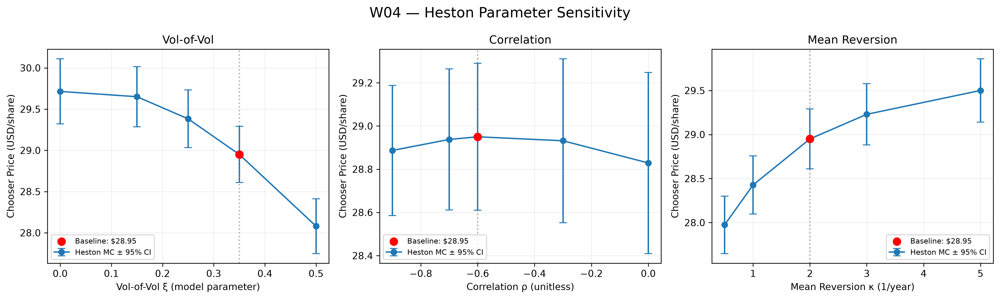
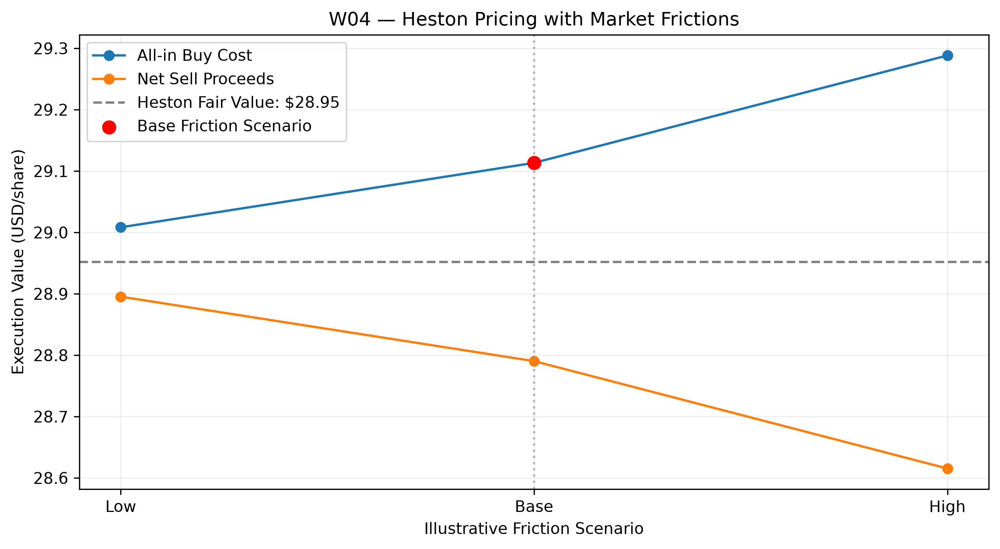
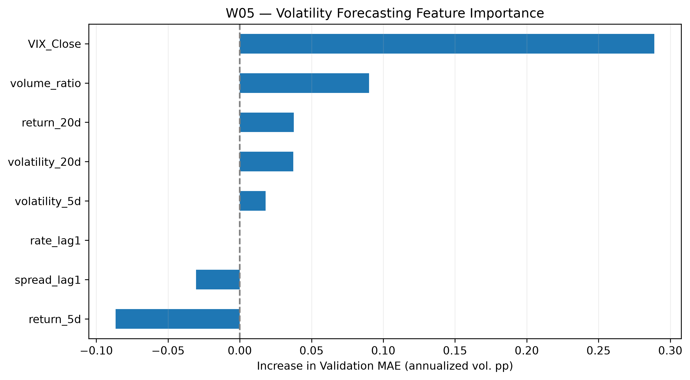
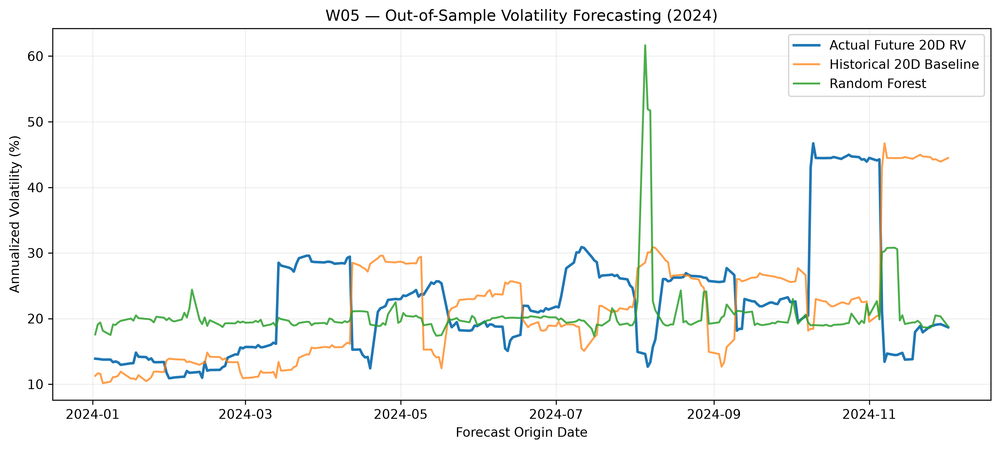

---
---
---

# W04–W05 — Combined Research Progress Report

**Project:** Advanced Chooser Option Pricing with Real-World Data & Machine Learning\
**Underlying:** JPM \| **Historical valuation date:** December 31, 2024\
**Research update:** November 4, 2026\
**Scope:** Heston Monte Carlo, exploratory market frictions, and ML volatility forecasting

## 1. Executive Summary

- **W04:** Implemented a Heston stochastic-volatility Monte Carlo benchmark for a Simple Chooser Option, with numerical validation and illustrative transaction-cost scenarios.
- **W05:** Trained a Random Forest to forecast future 20-trading-day realized volatility and compared it with a historical-volatility baseline.
- **Pending:** Market calibration, dynamic hedging costs, and full direct-pricing ML training; these are not claimed as completed.

## 2. W04 — Heston Monte Carlo

**Method:** Correlated stock/variance shocks; full-truncation Euler variance scheme; discounted European call + **adjusted put leg** (expiring at the choice date). Heston parameters are **illustrative, not market-calibrated**: mean reversion $\kappa=2$, vol-of-vol $\xi=0.35$, correlation $\rho=-0.60$, with $v_0=\theta=\sigma_{20d}^{2}$.

| Numerical result | Value |
|-------------------------------|----------------------------------------:|
| W03 dividend-adjusted BSM Chooser reference | **\$29.8290/share** |
| Heston Monte Carlo fair value (100,000 paths) | **\$28.9518/share** |
| Monte Carlo standard error | **\$0.0770/share** |
| 95% Monte Carlo confidence interval | **[\$28.8010, \$29.1027]/share** |
| Constant-variance (GBM) consistency check | **Passed**; 0.55 standard errors from BSM |
| Path-count experiment | SE decreased from **0.3488** (5K) to **0.0770** (100K) |
| Time-step experiment | Estimates had overlapping confidence intervals; further bias testing needed |

**Chart interpretation:** Within the tested *illustrative* parameter ranges, higher vol-of-vol lowered the estimated Chooser value and faster mean reversion raised it. The estimated effect of changing the price–variance correlation was relatively modest compared with Monte Carlo uncertainty. These patterns are scenario-specific, not general monotonicity claims.

**Numerical limitation:** The confidence interval measures Monte Carlo sampling error, not discretization bias or Heston parameter uncertainty. The BSM line is a *comparison benchmark*, not the Heston convergence target.

## 3. Market Frictions — Exploratory Execution Costs

We added a **transaction-level execution-cost layer** to the frictionless Heston fair value, using assumed full bid–ask spreads, additional adverse slippage, and a \$0.65 fee per hypothetical 100-share contract.

`Cost per share = half-spread + slippage + fee/100`\
`All-in buy cost = Heston fair value + cost per share`\
`Net sell proceeds = Heston fair value − cost per share`

| Scenario | Full spread ($/share) | Slippage ($/share) | Buy ($/share) | Sell ($/share) | Round trip (\$/share) |   |   |
|------------|-----------:|-----------:|-----------:|-----------:|-----------:|
| Low | 0.10 | 0.00 | 29.0083 | 28.8953 | 0.1130 |
| **Base** | **0.25** | **0.03** | **29.1133** | **28.7903** | **0.3230** |
| High | 0.50 | 0.08 | 29.2883 | 28.6153 | 0.6730 |

**Chart interpretation:** Higher assumed frictions widen the gap between all-in buying cost and net selling proceeds; **the frictionless theoretical value remains \$28.9518/share**. These inputs are hypothetical, **not observed Chooser quotes**. Dynamic delta-hedging costs are not modeled.

## 4. W05 — Future Volatility Forecasting

**Target:** JPM future 20-trading-day realized volatility, annualized.\
**Inputs:** Eight historical market features, including JPM returns, rolling volatility, volume, VIX, and lagged Treasury indicators.\
**Models:** Historical 20-day volatility baseline vs. Random Forest.\
**Chronological split:** Train 2018–2022 (**1,218**), validation 2023 (**230**), test 2024 (**232**). Target windows crossing period boundaries were excluded.

| Period     | Model             | MAE (vol. pp) ↓ | RMSE (vol. pp) ↓ |
|------------|-------------------|----------------:|-----------------:|
| Validation | Historical 20D    |       **6.081** |            8.455 |
| Validation | Random Forest     |           6.201 |        **8.143** |
| Test       | Historical 20D    |           9.306 |           12.482 |
| **Test**   | **Random Forest** |       **7.452** |       **10.558** |

On the 2024 test period, Random Forest reduced MAE by **19.9%** and RMSE by **15.4%** relative to the historical baseline; validation results were mixed.

**Feature-importance interpretation:** Validation-set permutation importance identified **VIX** as the most prominent model input. This indicates predictive dependence, not an independent causal effect; correlated features complicate attribution.

**Forecast-chart interpretation:** - **Stable periods:** Random Forest forecasts were comparatively smooth, but not consistently responsive to sudden volatility changes. - **August overprediction:** On **August 5, 2024**, the model forecast **61.66%** versus **14.60%** future realized volatility. With other inputs fixed, a local VIX scenario of **20 → 38.57** moved its prediction from **21.27% → 61.66%**. This is a model sensitivity test, **not causal identification**. - **October–November spike:** JPM daily returns of **+11.54% on November 6** and **−4.32% on November 7** contributed to elevated subsequent 20-day realized-volatility windows. Overlapping targets can make a few extreme returns appear as an extended high-volatility region.

**Forecast limitations:** Only one test year was evaluated; adjacent 20-day target windows overlap. Extreme moves and data sources should be independently verified before making event-level claims.

## 5. Direct Pricing ML — Design, Not Yet Trained

| Track | Prediction target | Current status |
|------------------------|------------------------|------------------------|
| A — Volatility forecasting | Future 20D realized volatility | Preliminary Random Forest and importance analysis completed |
| B — Direct Chooser pricing | **Synthetic, frictionless Heston theoretical value** | Inputs/target defined; large-scale label generation and ML training pending |

Direct-pricing inputs will include spot, strike, choice/expiry times, rates, dividend yield, and Heston parameters. Execution-adjusted prices can be studied as a *separate* target after agreeing on the market-friction scope. Synthetic labels assess how well ML approximates the assumed Heston model; they do **not** establish superiority against real-world option prices.

## 6. Mentor Alignment Requested & Next Steps

1.  **Market frictions:** Is the current bid–ask/slippage/fee execution-cost layer sufficient for an initial extension, or should we implement **dynamic delta-hedging transaction costs**?
2.  **Calibration:** Should we calibrate Heston parameters and friction assumptions to observable JPM option data now, or retain illustrative scenarios for the baseline stage?
3.  **Direct-pricing target:** Should the first ML model learn frictionless Heston theoretical prices, with execution-cost-adjusted targets evaluated separately?

**Next:** Confirm these modeling choices; expand numerical robustness/walk-forward forecasting tests; generate independent synthetic pricing labels and begin direct-pricing ML experiments.

**Project artifacts:** W04 Heston Monte Carlo notebook; W05 ML research notebook; associated figures under `04_Reports/weekly/figures/`.
