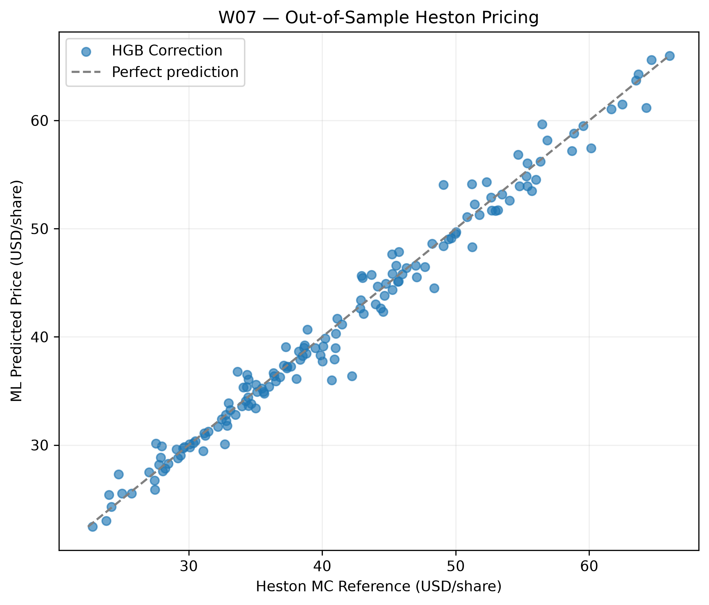
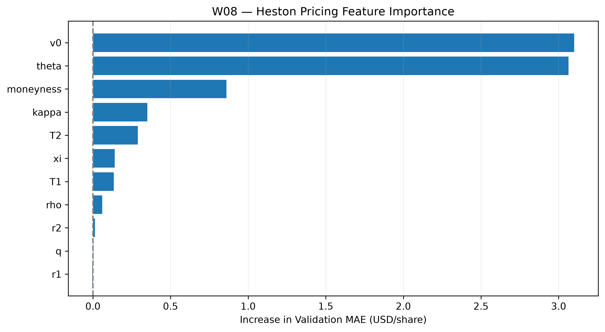
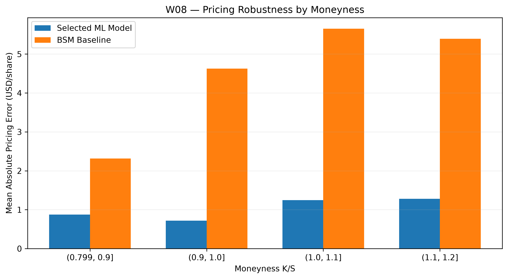

# W06–W08 — Combined Research Progress Report

**Project:** Advanced Chooser Option Pricing with Real-World Data & Machine Learning\
**Underlying:** JPM (historical reference); synthetic European Simple Chooser contracts\
**Historical reference date:** December 31, 2024\
**Research update:** November 10, 2026\
**Scope:** Heston Monte Carlo synthetic labels, direct-pricing ML, out-of-distribution robustness, computational efficiency, and Greeks diagnostics

## 1. Executive Summary

- **W06:** Generated **1,000 synthetic, frictionless Heston Chooser pricing scenarios** using full-truncation Euler Monte Carlo, antithetic sampling, and a BSM control variate. An independent raw Monte Carlo check was consistent with the BSM limit when vol-of-vol was set to zero.
- **W07:** Trained and compared **Random Forest (RF) Direct**, **RF Correction**, and **HistGradientBoosting (HGB) Correction** surrogates. The validation-selected HGB Correction model achieved **\$1.0320/share test MAE**, compared with **\$4.4915/share** for the BSM baseline.
- **W08:** Evaluated out-of-distribution parameter stress, Feller-condition subgroups, feature importance, moneyness-dependent errors, runtime, and finite-difference Greeks. The HGB model remained better than BSM on the stress set, but its **ML Gamma estimates were unstable and sometimes negative**, indicating that pricing accuracy alone does not establish suitability for hedging.
- **Mentor direction (November 10):** Retain Greeks instability as a documented limitation **while the goal remains a pricing surrogate, not hedging**; improve the numerical precision of synthetic Heston labels; **audit labels before market calibration**, rather than prioritizing broad ML accuracy/robustness tuning given limited external validity.
- **Not completed:** A systematic Heston label audit and numerical-precision upgrade, calibration to observed vanilla-option quotes, independent high-precision Heston Greeks, dynamic delta-hedging P&L, and transaction-cost-adjusted ML targets.

**Research distinction:** W05 forecasted *future realized volatility* from historical data. W06–W08 instead approximate **synthetic, risk-neutral Heston model values** given specified contract and model parameters. These are different prediction targets and are not interchangeable.

## 2. W06 — Synthetic Heston Pricing Dataset

**Objective:** Build a controlled theoretical-pricing dataset for the first **frictionless direct-pricing ML** experiment, consistent with the mentor's earlier recommendation to separate theoretical valuation from market-friction and hedging extensions.

**Method:** The stock and variance processes use correlated random shocks under assumed risk-neutral Heston parameters. Variance is simulated with a **full-truncation Euler scheme**, and the stock process is updated in log space. Each simulated Chooser value uses a discounted European call payoff at final expiry, plus an **adjusted put leg evaluated at the choice date**:

$$
\widehat V_{\mathrm H}=\frac{1}{N}\sum_{i=1}^N\left[e^{-r_2T_2}(S^{(i)}_{T_2}-K)^++e^{-r_1T_1}\left(Ke^{-f\Delta}-S^{(i)}_{T_1}e^{-q\Delta}\right)^+\right],
\qquad f=\frac{r_2T_2-r_1T_1}{T_2-T_1},\quad\Delta=T_2-T_1.
$$

Here the payoff decomposition assumes a **simple European chooser**, common strike and final expiration for the call/put alternatives, **deterministic rates**, and **continuous dividend yield**. The simulation uses the rate $r_1$ before the choice date and the implied forward rate $f$ afterward. The reported control-variate estimate is the BSM analytical Chooser value plus the simulated mean of **Heston payoff minus matched GBM payoff** (unit control-variate coefficient). Antithetic paths are paired when estimating Monte Carlo standard error (MC SE).

**Synthetic scenario design:** Latin Hypercube Sampling varies stock/strike moneyness, choice/expiry times, rates, dividend yield, initial and long-run variance, mean reversion, vol-of-vol, and stock–variance correlation. The pricing model takes **12 core inputs**: $S,K,T_1,T_2,r_1,r_2,q,v_0,\theta,\kappa,\xi,\rho$.

| Dataset split | Scenarios | Simulated paths per scenario | Median MC SE (USD/share) |
|-----------------|------------------:|------------------:|------------------:|
| Train | 600 | 4,096 | 0.2096 |
| Validation | 150 | 16,384 | 0.0995 |
| Test | 150 | 16,384 | 0.1016 |
| Stress | 100 | 16,384 | 0.1597 |
| **Total** | **1,000** | **252 time steps per scenario** | — |

**Validation:** In the constant-variance limit, setting $\xi=0$ and $\theta=v_0$ removes stochastic variance fluctuations. Using the **raw antithetic Monte Carlo estimate**, the GBM simulation returned **\$30.2186/share** against the BSM analytical value **\$29.8290/share**; the difference was **1.65 MC standard errors**, satisfying the stated four-SE consistency check. The illustrative baseline Heston control-variate estimate was **\$28.8682/share** with **MC SE \$0.1065/share** at 16,384 paths.

**Output:** `02_Data/processed/W06_Synthetic_Heston_Dataset.csv` (**1,000 rows × 29 columns**). The dataset includes pricing targets, a BSM comparator, individual MC SE estimates, simulation times, split identifiers, and an indicator for the Feller condition $2\kappa\theta\ge\xi^2$.

**Limitations:** Heston parameters are **sampled assumptions rather than calibrated market parameters**. MC SE measures sampling uncertainty, **not** time-discretization bias, parameter uncertainty, or distance from traded Chooser prices. The Feller flag is descriptive: failing the strict-positivity condition does not invalidate Heston but increases the importance of checking behavior near zero variance.

## 3. W07 — Direct Chooser Pricing with Machine Learning

**Objective:** Test whether a machine-learning surrogate can approximate frictionless Heston theoretical prices more accurately than the constant-volatility BSM reference, at lower evaluation cost after training.

**Methods:** Three models were fitted on the W06 training split: **RF Direct** predicts normalized Heston price; **RF Correction** and **HGB Correction** predict the normalized adjustment to BSM. Normalization removes the need to use the absolute stock-price level as a standalone feature:

$$
\underbrace{y_{\mathrm{direct}}}_{\text{RF Direct}}=\frac{V_{\mathrm H}}{S},
\qquad
\underbrace{y_{\mathrm{correction}}}_{\text{RF / HGB Correction}}=\frac{V_{\mathrm H}-V_{\mathrm{BSM}}}{S},
\qquad
\widehat V_{\mathrm H}=V_{\mathrm{BSM}}+S\widehat y_{\mathrm{correction}}.
$$

**Model selection used validation MAE only**; the held-out test set was used for subsequent comparison.

| Model              | Validation MAE | Validation RMSE |   Test MAE |  Test RMSE |
|---------------|--------------:|--------------:|--------------:|--------------:|
| RF Direct          |         2.5929 |          3.3284 |     2.2763 |     3.1232 |
| RF Correction      |         1.1285 |          1.4790 |     1.3017 |     1.7803 |
| **HGB Correction** |     **0.9124** |      **1.1631** | **1.0320** | **1.4625** |
| BSM Baseline       |         3.8187 |          4.9564 |     4.4915 |     5.9454 |

*All errors in USD per underlying share, against synthetic Heston MC reference labels; lower is better.*

On the test set, **HGB Correction reduced MAE by approximately 77.0%** relative to BSM. It is the **best model among those tested**, not proof of superiority over all potential pricing methods or observed market quotes.

**Chart interpretation:** Predictions generally follow the simulated Heston reference along the diagonal, with individual deviations that remain material for precision pricing.

**Label-uncertainty diagnostic:** The selected model's **test MAE was \$1.0320/share** versus **median MC SE \$0.1016/share**. The median ratio of individual absolute ML errors to their MC SE was **6.64**, and only **14.7%** of test predictions lay within the MC reference estimate ±1.96 MC SE. This comparison shows that the surrogate's observed discrepancies are frequently larger than sampling uncertainty; **MC confidence intervals are not predictive intervals for the ML model**. The eight largest-error test cases were saved for further analysis.

**Interpretation:** Learning the **Heston-minus-BSM correction** performed better than learning the full price directly in this experiment. The BSM baseline provides useful structure, but the learned correction does not automatically inherit every theoretical property of Heston prices.

**Output:** `03_Code/models/W07_Selected_Pricing_Model.joblib`, `02_Data/processed/W07_Model_Comparison.csv`, and `02_Data/processed/W07_Test_Error_Diagnostics.csv`.

## 4. W08 — Robustness, Feature Importance, Runtime, and Greeks

### 4.1 Out-of-distribution parameter stress

**Stress design:** The W06 stress sample simultaneously shifts **moneyness** $K/S$ from the usual 0.80–1.20 range to 1.20–1.35 and **vol-of-vol** $\xi$ from 0.08–0.50 to 0.50–0.65. This is a **parameter out-of-distribution test**, not a calibrated historical crash or market-liquidity stress.

| Split      | Model              | MAE (USD/share) | RMSE (USD/share) | Median MC SE |
|---------------|---------------|--------------:|--------------:|--------------:|
| Test       | BSM                |          4.4915 |           5.9454 |       0.1016 |
| **Test**   | **HGB Correction** |      **1.0320** |       **1.4625** |   **0.1016** |
| Stress     | BSM                |          4.1369 |           5.5649 |       0.1597 |
| **Stress** | **HGB Correction** |      **1.6351** |       **2.1591** |   **0.1597** |

The selected model's MAE increased by approximately **58.4%** relative to its ordinary test result, while remaining below the BSM comparator on the stress set. Because **two parameter ranges changed at once**, this experiment does **not** isolate which change caused the deterioration.

**Feller subgroup diagnostic:** Among the 100 stress cases, **73 failed** $2\kappa\theta\ge\xi^2$ and 27 satisfied it. The corresponding MAEs were **\$1.7010** and **\$1.4570/share**, respectively. In the ordinary test set, the failed/satisfied groups had **30/120** cases and MAEs **\$0.9508/\$1.0524**. These descriptive differences are confounded by the sampled parameter distributions; **failure of the Feller condition is not established as a cause of prediction error**.

**Worst-case inspection:** The largest observed stress absolute error was **\$6.0580/share (case 906)**. The largest ordinary test absolute error was **\$5.8522/share (case 896)**. These examples identify scenarios for more targeted robustness experiments, rather than demonstrating a uniform error bound.

### 4.2 Feature importance and moneyness

**Method:** Validation-set permutation importance; the reported quantity is the increase in MAE when one model input is shuffled across observations. This measures **predictive reliance**, not causation or the economic derivative of price with respect to that feature.

| Feature                      | Mean increase in validation MAE (USD/share) |
|------------------------------|--------------------------------------------:|
| Initial variance (`v0`)      |                                  **3.0997** |
| Long-run variance (`theta`)  |                                  **3.0639** |
| Moneyness (`K/S`)            |                                      0.8605 |
| Mean reversion (`kappa`)     |                                      0.3505 |
| Vol-of-vol (`xi`)            |                                      0.1409 |
| One-period rate input (`r1`) |                                     -0.0036 |

**Chart interpretation:** The HGB model relies particularly on the initial and long-run variance inputs. The small negative value for `r1` is compatible with finite-sample permutation variability (**SD 0.0061**) and **must not** be read as evidence that higher rates lower the Chooser price. Independently shuffling rates can also disrupt the joint rate-term-structure relationships used in scenario generation; a structured permutation would be a possible future diagnostic, not a required change to this week's results.

**Moneyness buckets (ordinary test set):**

| $K/S$ bucket | HGB mean absolute error | BSM mean absolute error |
|--------------|------------------------:|------------------------:|
| 0.80–0.90    |                  0.8775 |                  2.3158 |
| 0.90–1.00    |                  0.7210 |                  4.6278 |
| 1.00–1.10    |                  1.2475 |                  5.6543 |
| 1.10–1.20    |                  1.2805 |                  5.3954 |

The selected surrogate improves on BSM in every **reported ordinary-test moneyness bucket**; this does not imply it generalizes equally well beyond those buckets.

### 4.3 Computational efficiency

| Evaluation mode             |       Observed time |
|-----------------------------|--------------------:|
| Row-by-row ML inference     | 13.9602 ms/contract |
| Batch ML inference          |  0.4221 ms/contract |
| Recorded Heston Monte Carlo | 45.2986 ms/contract |

The recorded comparison gives approximately **3.2×** MC/ML time for row-by-row inference and **107.3×** for batch inference. This is a **local timing experiment** comparing current ML evaluation with recorded MC-generation times, not a controlled deployment benchmark; it excludes model training and does not equalize pricing accuracy.

### 4.4 Finite-difference Greeks consistency

**Method:** The test holds strike and other model parameters fixed, bumps spot, **recomputes** $K/S$ and the BSM reference price, and uses centered finite differences of the ML-predicted price:

$$
\widehat\Delta_{\mathrm{ML}}\approx\frac{\widehat V(S+h)-\widehat V(S-h)}{2h},\qquad
\widehat\Gamma_{\mathrm{ML}}\approx\frac{\widehat V(S+h)-2\widehat V(S)+\widehat V(S-h)}{h^2}.
$$

**Illustrative finding (case 750):**

| Relative spot bump | ML Gamma estimate |
|--------------------|------------------:|
| ±0.25%             |          0.015771 |
| ±0.50%             |     **-0.128311** |
| ±1.00%             |     **-0.019457** |

Under the stated **frictionless Simple European Chooser assumptions** with fixed Heston dynamics and other parameters, the theoretical price is convex in initial spot; negative Gamma is therefore a **shape-consistency warning** for the ML approximation. The HGB correction is not constrained to be smooth or convex, and finite-difference results may be sensitive to the bump size and model's tree-based response. **These are ML-derived numerical Greeks, not independently verified Heston Greeks.** Price-level accuracy alone is insufficient to establish a hedging-grade model.

## 5. Assumptions & Limitations

| Dimension | Current scope | What is not established |
|------------------------|------------------------|------------------------|
| Target | Synthetic, frictionless **Heston theoretical Chooser price** | Traded Chooser market price or live trading profitability |
| Contract | Simple **European** chooser; one choice date; same strike/final expiry | American exercise or more complex chooser structures |
| Parameters | Sampled stock/contract and assumed Heston parameters | Calibration to observed JPM vanilla-option quotes; variance-risk-premium estimation |
| Numerical labels | Full-truncation Euler, 252 steps, antithetic paths, BSM control variate | Discretization-bias bound or alternative-scheme validation |
| ML evaluation | Independent sampled validation/test splits and one joint OOD stress design | Broad market-regime generalization or parameter-by-parameter stress attribution |
| Greeks | Finite differences of **ML predictions** at fixed strike | Accurate Heston hedge ratios or stable convexity across all scenarios |
| Trading frictions | Excluded from the W06–W08 supervised target | Bid–ask-adjusted targets, dynamic hedge costs, and hedging P&L |

## 6. Mentor Feedback & Future Work

**Previously agreed direction:** Tyler advised focusing the first direct-pricing ML experiment on the **frictionless Heston theoretical Chooser value** and treating market calibration, execution frictions, and dynamic hedging as separate possible extensions. W06–W08 address the initial pricing-surrogate objective.

**Mentor feedback received November 10, 2026 — scope decisions:**

1.  **Greeks versus pricing-surrogate scope.** For a project whose current objective is a **machine-learning pricing surrogate**, the negative and bump-sensitive ML Gamma estimates may be **documented as a limitation**. **The current surrogate must not be used for hedging.** If hedging becomes a near-term research objective, Greeks consistency would have to be addressed before that extension could be considered reliable.
2.  **Synthetic-label numerical precision.** The synthetic Heston pricing labels **require stronger numerical accuracy and validation**. The present MC SE estimates quantify sampling error but do not establish that the full-truncation Euler time discretization is sufficiently accurate.
3.  **Priority and external validity.** Conduct a **label audit first**, followed by **Heston market calibration**. Tyler did **not** recommend large-scale ML accuracy or robustness optimization at this stage, since successful prediction of *synthetic Heston labels* has limited external validity for observed market prices.

**Resulting research plan (proposed implementation of the mentor guidance, not yet completed):**

| Sequence | Proposed work | Evidence or decision sought |
|------------------------|------------------------|------------------------|
| **W09 — Label audit** | Review W06 labels by split, price range, MC SE, Feller status, and outlier cases; check input consistency and inspect high-error W07/W08 scenarios. Audit raw MC and control-variate estimates without treating their difference as an independent error estimate. | Identify questionable labels and select representative scenarios for more precise reference pricing. |
| **Numerical-precision validation** | For representative regular, stress, high-error, and near-zero-variance scenarios, increase MC path counts and compare finer time grids (e.g., 252/504/1,008 steps). Distinguish sampling uncertainty from time-step bias and, where feasible, cross-check an alternative numerical scheme. | Determine whether the label errors are sufficiently controlled; **regenerate affected labels only if the audit justifies it**, then reassess ML results if their targets change materially. |
| **Market calibration** | After numerical-label quality is established, obtain appropriate dated **JPM vanilla-option quotes** and calibrate Heston parameters using a clearly specified loss function and valuation conventions. | Replace illustrative parameter choices with market-informed risk-neutral estimates and examine fit on observed vanilla options. |
| **External-validity assessment** | Evaluate whether the calibrated parameter region is covered by the synthetic-surrogate training domain and whether theoretical Chooser estimates are stable under those inputs. | Assess how much of the surrogate's synthetic-domain performance can reasonably be transferred to a market-calibrated setting; **do not claim validation against traded Chooser prices without those quotes**. |

**Deferred unless the scope changes:** Large-scale RF/HGB hyperparameter tuning or broad synthetic-domain robustness optimization; ML-Greeks/shape-preserving retraining; dynamic hedging P&L; transaction-cost-adjusted direct-pricing labels. The existing W08 Greeks result remains an explicit limitation, not an implemented hedging model.

**Interpretation of the W06–W08 result after mentor review:** The validation-selected HGB Correction surrogate is promising **relative to the present synthetic Heston reference and BSM comparator**, but its measured MAE, speedup, and stress behavior cannot establish market pricing accuracy until the numerical-reference quality is audited and the model assumptions are connected to observed options through calibration.

**Core deliverables:** `W06_Synthetic_Heston_Pricing.ipynb`, `W07_Heston_Direct_Pricing_ML.ipynb`, `W08_Heston_Pricing_Robustness.ipynb`, the W06 synthetic CSV, W07 selected model and comparison/diagnostic CSVs, and the W07–W08 figures referenced above.

*Evidence note: Results reflect the currently saved GitHub notebook outputs and processed CSVs; this report does not claim an independent fresh-kernel re-execution of the full computational pipeline. The figures use the same relative `figures/` paths as the earlier weekly reports, so the Markdown should be placed in `04_Reports/weekly/` for those links to render in the project.*
